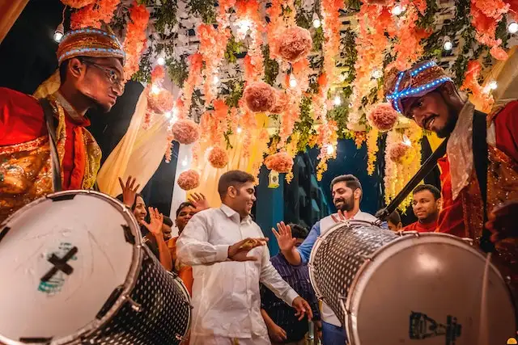

# Gauri Greens - Website Clone 🏰🌿

> Full-fidelity, high-performance website clone of **[Gauri Greens](https://gaurigreens.com/)** — Bhopal's premier 5-acre luxury wedding destination, marriage garden, and banquet resort on Hoshangabad Road (NH-12), Misrod, Bhopal.



---

## 🌟 Key Features

- **Royal Wedding Design:** Deep emerald green (`#1d4631`) and metallic gold (`#c59b27`) palette with elegant typography (*Playfair Display*, *Cinzel*, *Plus Jakarta Sans*).
- **Interactive Venue Showcase:** Dynamic tab navigation between:
  - **Atharvv Lawn:** 32,500 Sq. Ft. | 1,400–1,600+ Pax | 600 Car Parking
  - **Pratham Lawn:** 24,000 Sq. Ft. | 500–700 Pax | Open-Air Gazebo Setting
  - **Royal Banquet Hall:** 3,500 Sq. Ft. | 300–400 Pax | 100% Central AC | 2,000+ Events
  - **AC Rooms & Dormitories:** 20+ Deluxe Suites (250 Sq. Ft.) + 600 Sq. Ft. Luxury Dormitory
- **Dedicated Subpages:**
  - `atharvv-lawn.html`
  - `pratham-lawn.html`
  - `banquet-hall.html`
  - `rooms.html`
  - `weddings.html`
  - `contact.html`
- **Filterable Photo & Decor Gallery:** With interactive full-screen Lightbox modal.
- **Eco-Friendly Concept:** Highlights Gauri Greens' signature *Green Invitations* initiative.
- **Direct WhatsApp Booking Engine:** Pre-fills event inquiries and redirects directly to WhatsApp (`+91 95890 08911`).
- **Official FAQs & Testimonials:** Real client reviews and venue Q&As from the original site.
- **Embedded Google Maps:** Directions to Misrod, Hoshangabad Road (NH-12), Bhopal.
- **Mobile Responsive:** 100% responsive across mobile, tablet, and desktop with off-canvas navigation.

---

## 📂 Project Structure

```
gauri-greens-clone/
├── index.html            # Main Homepage
├── atharvv-lawn.html     # Atharvv Lawn Detailed Page
├── pratham-lawn.html     # Pratham Lawn Detailed Page
├── banquet-hall.html     # Royal Banquet Hall Page
├── rooms.html            # Luxury Accommodation & Dormitory Page
├── weddings.html         # Weddings, Decor & Catering Page
├── contact.html          # Contact & Location Page
├── README.md             # Project Documentation
└── assets/
    ├── css/
    │   └── style.css     # Complete styling & animations
    ├── js/
    │   └── main.js       # Navigation, tabs, lightbox & WhatsApp booking
    └── images/           # Authentic brand logos, banners, lawns & decor photos
```

---

## 🚀 How to Run Locally

You can open `index.html` directly in any web browser, or run a local lightweight server:

### Using Python:
```bash
python -m http.server 5500
```
Then visit: `http://localhost:5500`

### Using Node / npx:
```bash
npx serve
```

---

## 📞 Contact Information (Official)
- **Venue:** Gauri Greens Marriage Garden & Resort
- **Location:** Hoshangabad Road (NH-12), Near Misrod, Bhopal, Madhya Pradesh 462047
- **Phone:** +91 95890 08911
- **Email:** prateek@gaurigreens.com
- **Original Website:** [https://gaurigreens.com/](https://gaurigreens.com/)
