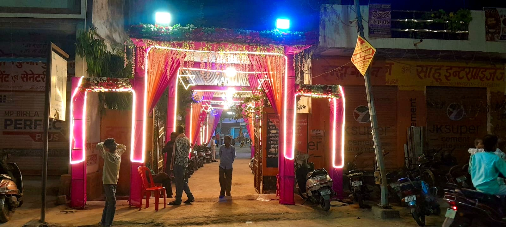

# 🌿 Indra Marriage Garden & Banquet | Jhansi

> High-fidelity, luxury wedding venue website for **Indra Marriage Garden** — Jhansi's premier open lawn and banquet celebration destination located at Bahar Unnao Gate Main Road, Near Naogoji Kua, Jhansi, Uttar Pradesh - 284002.



---

## 🌟 Key Features & Structure

- **Royal Wedding Design:** Deep emerald green (`#1d4631`) and metallic gold (`#c59b27`) palette with elegant typography (*Playfair Display*, *Cinzel*, *Plus Jakarta Sans*).
- **12 Authentic On-Site Photos:** Featuring real captured moments of Indra Garden:
  - `indra-stage-mandap.jpg` — Royal Stage & Floral Mandap
  - `indra-hero-night.jpg` — Starlit Evening Lawn Illumination
  - `indra-dining-pavilion.jpg` — Covered Weatherproof Dining Pavilion
  - `indra-stage-portrait.jpg` — Royal Throne & Stage Close-up
  - `indra-lawn-daytime.jpg` — Lush Green Open Turf
  - `indra-aerial-lawn.jpg` — Expansive Grounds Overview
  - `indra-entrance-gate.jpg` — Grand Entrance on Bahar Unnao Gate
  - `indra-banquet-setup.jpg` — Banquet Seating & Guest Arrangements
  - `indra-night-decor.jpg` — Ambient Night Lighting & Fairylights
  - `indra-venue-view-1.jpg`, `2.jpg`, `3.jpg` — Campus Perspectives & Walkways
- **Dedicated Venue Spaces:**
  - **The Grand Open Lawn:** Expansive, open-air green grounds for 1,200–1,600+ guests with wide baraat entry.
  - **Covered Dining Pavilion:** Weatherproof catering & buffet space with dedicated handwash facilities.
  - **Royal Stage & Mandap:** Bespoke stage styling, throne backdrops, and photography spotlights.
  - **Banquet & Dressing Suites:** Private air-conditioned bridal dressing suites with attached washrooms.
- **Dedicated Subpages:**
  - `atharvv-lawn.html` (The Grand Open Lawn)
  - `pratham-lawn.html` (Covered Dining Pavilion)
  - `banquet-hall.html` (Royal Stage & Mandap)
  - `rooms.html` (Banquet & Dressing Suites)
  - `weddings.html` (Weddings & Decor)
  - `contact.html` (Contact Us & Directions)
- **Direct WhatsApp Booking Engine:** Pre-fills event inquiries and redirects directly to WhatsApp (`+91 98765 43210`).
- **Interactive Lightbox Modal:** Full-screen zoom and inspection for all 12 gallery photos.
- **Google Maps Directions:** Live map pinned to Bahar Unnao Gate Main Road, Near Naogoji Kua, Jhansi.
- **Mobile Responsive:** 100% responsive across mobile, tablet, and desktop devices.

---

## 📁 Repository Structure

```
gauri-greens-clone/
├── index.html            # Main Homepage
├── atharvv-lawn.html     # The Grand Open Lawn Page
├── pratham-lawn.html     # Covered Dining Pavilion Page
├── banquet-hall.html     # Royal Stage & Mandap Page
├── rooms.html            # Banquet & Dressing Suites Page
├── weddings.html         # Weddings, Decor & Catering Page
├── contact.html          # Contact & Location Page
├── README.md             # Project Documentation
└── assets/
    ├── css/
    │   └── style.css     # Luxury styling & responsive layout
    ├── js/
    │   └── main.js       # Navigation, tabs, lightbox & WhatsApp booking
    └── images/           # 12 Authentic Indra Garden photos + branding assets
```

---

## 🚀 How to Run Locally

You can open `index.html` directly in any web browser, or run a local lightweight server:

### Using Python:
```bash
python -m http.server 5500
```
Then visit: `http://localhost:5500`

---

## 📞 Contact Information (Official)
- **Venue:** Indra Marriage Garden & Banquet
- **Address:** Bahar Unnao Gate Main Road, Near Naogoji Kua, Jhansi, Uttar Pradesh - 284002
- **Phone / WhatsApp:** +91 98765 43210
- **Email:** indragardenjhansi@gmail.com
- **Visiting Hours:** 9:00 AM – 9:00 PM (Open 7 Days)
